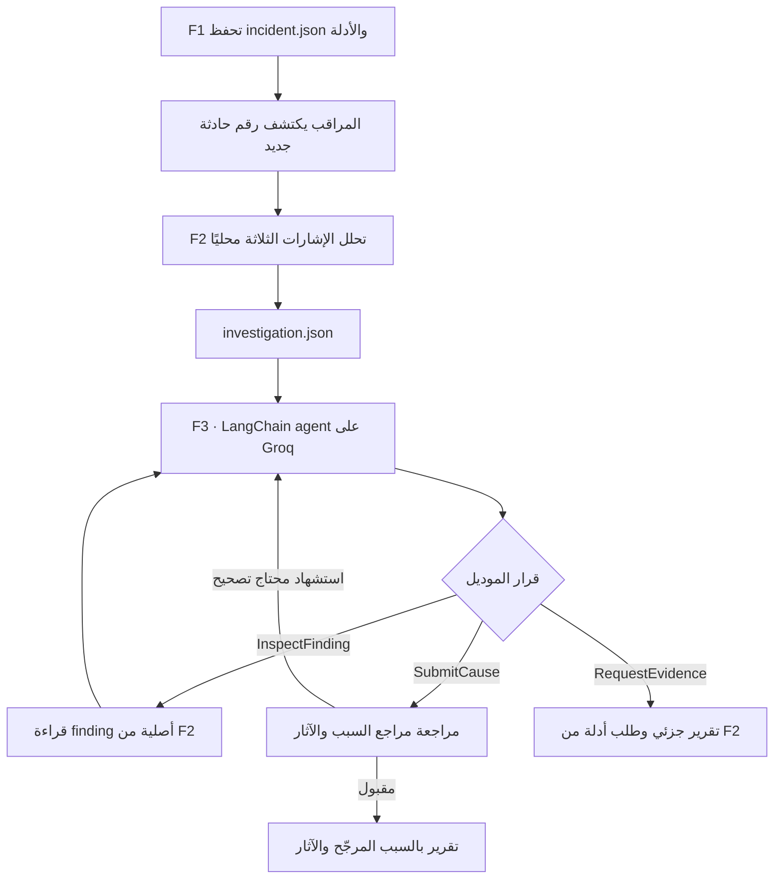

# دليل F3 في Observa — من ظهور الـincident لحد تقرير السبب والأثر

ميزة **Correlation Agent** بتجاوب على سؤالين: فين بدأ الفشل على الأرجح؟ وإيه الأدلة اللي تربط البداية دي بالأعراض اللي ظهرت بعدها؟ **F1** بتكتشف الحادثة وبتحفظ عينة من الأدلة. **F2** بتحلل الـlogs والـmetrics والـtraces كل إشارة لوحدها. **F3** بتستلم نتيجة F2، وبتستخدم موديل يربط الملاحظات ويقدّم تفسير قابل للمراجعة. التقرير الناتج هو المدخل المقترح لمرحلة الـrecommendation.

لو فاتح المشروع لأول مرة، ابدأ بدالة `process_incident()` في [docker/run.py](docker/run.py). هتلاقي فيها تلات عمليات ورا بعض: تشغيل F2، استدعاء `correlate()`، وحفظ التقرير. بعد كده افتح [agent/graph.py](agent/graph.py) عشان تشوف إيه اللي بيحصل جوه الاستدعاء التاني.

## 1. إيه اللي بيبدأ التحقيق؟



حاوية `investigate` بتشوف فولدر `alert-detection-grouping/reports` باسم `/reports` بصلاحية القراءة. لما F1 تنشر `INC-…/incident.json`، المراقب يقدر يكتشفها حتى لو F1 والمراقب شغّالين في حاويتين مختلفتين. اخترنا الملف كنقطة تسليم لأن F1 بتنشره بالفعل بعد تجهيز الأدلة. كده نقدر نضيف F3 من غير تغيير طريقة شغل F1. [ربط المجلدات](compose.yaml) · [كود النشر في F1](../alert-detection-grouping/observa_alerts/report.py)

دالة `discover()` بتسجل أرقام الحوادث في `runs/.watch.sqlite3`. **أول فحص فقط** بيسجّل الموجود على إنه `existing`، عشان تشغيل الميزة للمرة الأولى ما يبعتش كل تاريخ الحوادث للموديل. أي رقم جديد بيتسجل `pending`. دالة `process_next()` بتختار حادثة جاهزة، وتعالج واحدة في المرة. لما المراقب يبقى فاضي بينتظر ثانيتين قبل الفحص التالي. الاحتفاظ بالجدول على جهازك يسمح له بعد إعادة التشغيل يلقط الحوادث اللي ظهرت وهو متوقف. وحدة التشغيل هنا هي **رقم الحادثة**؛ تحديث الـsnapshot لنفس الرقم ما بيبدأش run تلقائية تانية. [docker/watch.py](docker/watch.py)

## 2. إيه اللي F2 بتسلّمه لـF3؟

المراقب بيشغّل `observa_investigation` برقم الحادثة ومعاه `--no-llm`. الـorchestrator الموجود في F2 بيشغّل محللات الإشارات الثلاثة، وبيجمع ملاحظاتهم عن الـsnapshot في `InvestigationResult`. في مسار Docker اخترنا نحسب الملاحظات محليًا ونستخدم الموديل في مرحلة تفسير العلاقة بينها. النتيجة بتتحفظ باسم `investigation.json`؛ تقدر تفتحها وتقارن اللي F2 شافته باللي F3 استنتجته. [نقطة دخول F2](../investigation/observa_investigation/__main__.py) · [العقد المشترك](../investigation/observa_investigation/contracts.py)

كل finding بتقول أنهي خدمة ظهر فيها الحدث، وإيه الملاحظة أو الاستنتاج، ومراجع الأدلة، وحدود العينة. حالة `partial` معناها إن التحليل فيه نقص؛ بعض الملاحظات فيه تظل صالحة للاستخدام. لو الحالة الكلية `failed`، المراقب يعيد المحاولة. أما لو فيه نتيجة جزئية فيسلّمها لـF3 عشان تقيّم كفاية الأدلة للسؤال المطروح.

## 3. فين كود الـagent، وفين قرار الموديل؟

نقطة الدخول من Python هي `correlate(investigation)`. بتبني الـagent عن طريق `build_graph()` وبعدها تنادي `.invoke()`. داخل `build_graph()` هتلاقي استدعاء **`create_agent` من LangChain**: بياخد الموديل، وتعليماته، والتلات أدوات المسموح بها، وشكل الـstate، والدوال اللي بتشتغل قبل وأثناء استدعاءات الموديل. LangChain بتدير دورة الموديل والأدوات فوق LangGraph. استخدمناها عشان قرار «أفحص دليل، أقدّم تفسير، ولا أطلب بيانات؟» يبقى قرار الموديل عند قراءة الحالة. [بناء الـagent](agent/graph.py)

قبل أول استدعاء، `prepare()` بتتحقق من شكل دخل F2 وبتجهّز سياق التحقيق. دالة `collect_supported_observations()` بتختار الملاحظات اللي ينفع الاستشهاد بيها. لازم الملاحظة تكون من إشارة متوافقة مع مكانها في النتيجة، وحالتها مكتملة أو جزئية، وفيها مرجع صالح ومرتبط بالحالة ويدعمها. الكود بيراجع إن المرجع تابع لنفس الـincident والإشارة، وبيستبعد الملاحظة من الـsnapshot لو فيها مرجع صالح بيناقضها. بعد الفلترة كل ملاحظة بتاخد رقم. فايدة الترقيم إن الكود يقدر يحوّل اختيار الموديل لمرجع F2 الأصلي، ويرفض رقم غير موجود. [تحضير الأدلة](agent/tools.py)

الموديل بيستقبل جدول الملاحظات المرقّمة، وحالات الإشارات، وملخصات الـfindings الأصلية، ودرجة عدم اليقين والأدلة الناقصة. يعني عنده سياق أوسع من الأدلة المسموح له يستشهد بيها. فيه مدخل اختياري اسمه `memory_lookup` يقدر يضيف ملاحظات تاريخية عن الخدمات المتأثرة. مسار Docker الحالي ما بيوصلش مخزن ذاكرة، فالقائمة بتكون فاضية. ولو اتوصل لاحقًا، الملاحظات التاريخية تفضل سياق، مش إثبات لحادثة النهارده.

الموديل المستخدم هو `openai/gpt-oss-120b` على **Groq**. الكلاس `ChatOpenAI` هنا عميل LangChain متوافق مع واجهة Groq، والعنوان المضبوط في الكود هو `https://api.groq.com/openai/v1`. المفتاح بيتقري من `GROQ_API_KEY` في البيئة أو من ملف `.env` في جذر `correlation_agent`. الـsystem prompt بيطلب من الموديل يفرّق بين بداية العطل وأثره، ويتعامل مع نصوص الحادثة كبيانات، ويتجنب استنتاج ترتيب زمني لمجرد إن عرضين ظهروا مع بعض. [إعداد Groq والـprompt](agent/model.py)

| أداة الموديل | إمتى يستخدمها؟ | إيه اللي بيحصل بعدها؟ |
|---|---|---|
| `InspectFinding` | محتاج يشوف finding أصلية بما فيها الأدلة وعدم اليقين | بياخد التفاصيل المحفوظة في نتيجة F2 ويقرر الخطوة التالية. |
| `SubmitCause` | عنده تفسير مرجّح يقدر يربطه بأدلة | بيرسل أسباب مرتّبة، وأرقام الملاحظات الداعمة، والآثار المقترحة. الكود بيراجعها قبل قبول النتيجة. |
| `RequestEvidence` | المعطيات تسمح بأكتر من تفسير أو ناقص دليل حاسم | بيحدّد الإشارة المطلوبة، وإيه اللي محتاجه، وليه. الناتج يشمل `FollowUpRequest` بصيغة F2. |

الـagent ملزم يختار أداة واحدة في كل دور. لو استشهد برقم غلط أو بإشارة لا تدعم الخدمة المقترحة، الأداة ترجع له سبب الرفض عشان يصحّح أو يطلب دليل. حدّ الخمس استدعاءات بيحط سقف لوقت وتكلفة **محاولة التحقيق الواحدة**. لما نتيجة صالحة تتكتب في الـstate، الحلقة بتنتهي. الـstate كمان شايلة التحقيق الأصلي، والملاحظات، والذاكرة الاختيارية. تعريف المدخلات والمخرجات بأنواع Pydantic بيخلّي أخطاء شكل البيانات تظهر قبل تسليمها للمرحلة التالية. [الأدوات وقواعد القرار](agent/tools.py) · [تعريفات الحالة والنتيجة](agent/state.py)

## 4. إزاي بنقبل سبب ونحوّله لتقرير؟

الموديل هو اللي بيقترح الخدمة والتفسير وبيرتّب المرشحين. الكود بيقبل المرشح الأول كسبب مرجّح لما تكون له **ملاحظات مباشرة من نوعين مختلفين من الإشارات على نفس الخدمة وفي نفس الـsnapshot**. مثال: logs وmetrics ينفعوا؛ عشرة logs تظل نوع إشارة واحد. ده بيقلل احتمال قبول تفسير اعتمد على تكرار نفس العرض. ولو أثر المشكلة ظهر في خدمة تانية، ليه خطوة منفصلة تستشهد بملاحظات الخدمة المتأثرة.

في التقرير المكتمل، الخطوة الأولى نوعها `probable_origin`. كل أثر بعدها نوعه `inferred_effect` وعنده `follows_step` بيشير لخطوة أسبق. كود التقرير بيراجع إن الخطوة المشار إليها موجودة، وإن مراجع الأثر تخص الخدمة المذكورة ونفس الـsnapshot. الترتيب بيشرح **العلاقة السببية المقترحة**؛ إثبات التوقيت الفعلي محتاج دليل فيه توقيت. الكود بيتحقق من المراجع، لكن تقييم صحة التفسير نفسه يفضل قابل للمراجعة البشرية. [بناء التقرير](reporting/report.py)

لو الأدلة غير كافية، النتيجة بتبقى `needs_more_analysis` و`final_root_cause` فاضية. التقرير يعرض الملاحظات المستقلة والفجوات، وملف النتيجة الكاملة يحتفظ بطلب المتابعة. **المراقب الحالي بيحفظ الطلب ويعتبر تسليم F3 تم؛ إرسال الطلب مرة تانية لـF2 محتاج مستهلك ينفّذه.** وبالمثل، تقرير JSON جاهز للـrecommendation، وتشغيل المرحلة التالية مسؤولية التكامل معها.

## 5. مثال من تشغيل المشروع

في الحادثة المحلية `INC-df04b0733cb01b718f20`، كانت نتيجة F2 جزئية، وفيها ملاحظة من كل إشارة عن `orders-service`.

| الإشارة | إيه اللي اتشاف في العينة؟ | بيساعدنا نفهم إيه؟ |
|---|---|---|
| Logs | 46 سجلّ `order_failed` بسبب `db_pool_timeout` خلال 18.1 ثانية | فشل الطلبات ظهر وقت انتظار اتصال بقاعدة البيانات. |
| Metrics | قيمة `pool_pressure` كانت 1.0 مقابل حد 0.9 | فيه ضغط على مجموعة الاتصالات المتاحة. |
| Traces | 12 span فاشل عند `db.acquire`، وp95 حوالي 505 ms | الـtrace حدّدت عملية الحصول على الاتصال كمكان ظهور الفشل. |

الـagent رجّح إن **تشبّع مجموعة اتصالات قاعدة البيانات في orders-service أدّى لانتهاء مهلة الحصول على اتصال، وده ظهر كفشل للطلبات**. الحالة النهائية كانت `completed` والتقرير احتفظ بالفجوات اللي جاية من F2. كفاية الأدلة لترجيح السبب بتجاوب على سؤال مختلف عن اكتمال كل العينات. مثلًا، تحديد *ليه* مجموعة الاتصالات اتشبّعت أصلًا محتاج دليل إضافي.

## 6. إيه اللي هتلاقيه على جهازك؟

نتائج المراقبة بتتحفظ في `correlation_agent/runs/<incident-id>/`. دول الأربع ملفات لنفس التحقيق:

| الملف | تفتحه إمتى؟ |
|---|---|
| `investigation.json` | تشوف الأدلة اللي كانت متاحة **قبل** تفسير الموديل. |
| `correlation.json` | تراجع القرار الكامل، والمرشحين، والفجوات، وطلب المتابعة إن وُجد. |
| `report.json` | تمرّر تقريرًا منظمًا للمرحلة التالية. فيه رقم الحادثة والتشغيل، والحالة، والملخص، والخطوات والأدلة. |
| `report.md` | تقرأ نفس التقرير أو تشاركه مع زميل. التحويل من JSON إلى Markdown محلي، فمفيش تكلفة استدعاء جديد أو اختلاف بين تفسيرين. |

فيه [مثال JSON جاهز](examples/example_report.json) و[نسخته المقروءة](examples/example_report.md) لسيناريو تجريبي تاني: امتلاء القرص في خدمة التخزين وتأثيره على خدمة الطلبات. افتحهم جنب بعض عشان تشوف إزاي نفس `evidence_ids` بتظهر تحت كل خطوة.

## 7. التشغيل، وإيه اللي يحصل لو خطوة فشلت

من جذر مشروع Observa، بعد تشغيل الـdummy app وF1 وضبط المفتاح في `correlation_agent/.env`:

```powershell
docker compose -f correlation_agent/compose.yaml up --build -d
docker compose -f correlation_agent/compose.yaml logs -f investigate
```

لما يظهر `F2: reading saved evidence` يبقى المراقب التقط الـincident. الرسالة `F3: correlating` معناها إن خرج F2 بقى جاهز والموديل بيشتغل عليه. و`report saved` معناها إن الملفات اتكتبت على جهازك. الحاوية بتقرأ تقارير F1 والمفتاح وقت التشغيل، وبتكتب النتائج في مجلد منفصل. قائمة ملفات البناء بتحصر اللي يدخل الصورة في الكود والاعتماديات. [Compose](compose.yaml) · [Dockerfile](docker/Dockerfile) · [ملفات البناء المسموح بها](docker/Dockerfile.dockerignore)

لو مرحلة فشلت، الحادثة تفضل في الطابور. التأخير قبل إعادة المحاولة بيبدأ بـ5 ثواني وبيتضاعف لحد 5 دقايق. المراقب بيكتب كل ملف مؤقتًا ثم يستبدله بعد اكتمال الكتابة. لو `investigation.json` اتحفظ وبعده Groq فشل، المحاولة التالية تستخدم نتيجة F2 المحفوظة. ولو `correlation.json` اتحفظ قبل انقطاع كتابة التقرير، الكود يكمل استخراج التقرير من نفس النتيجة. ده بيوفّر إعادة التحليل بعد الأعطال؛ لو الانقطاع حصل **قبل حفظ رد الموديل**، المحاولة التالية ممكن تستدعيه تاني.

للتجربة على ملف F2 أو لتحويل تقرير محفوظ، استخدم الـCLI من جذر المشروع. الأمر الأول بيستدعي Groq، والتاني بيقرأ تقريرًا موجودًا محليًا:

```powershell
python -m pip install -r correlation_agent/requirements.txt
python -m correlation_agent investigation/fixtures/investigation_result_completed.json --report-out correlation-report.json
python -m correlation_agent --from-report correlation-report.json --report-out correlation-report.md
```

في تكامل Python، نقطة الدخول العامة هي `from correlation_agent import correlate`، وبعد `result = correlate(investigation)` هتلاقي التقرير في `result.report`. [واجهة سطر الأوامر](__main__.py) · [واجهة Python](__init__.py)
